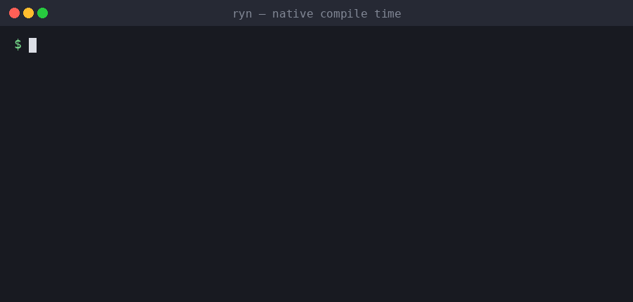
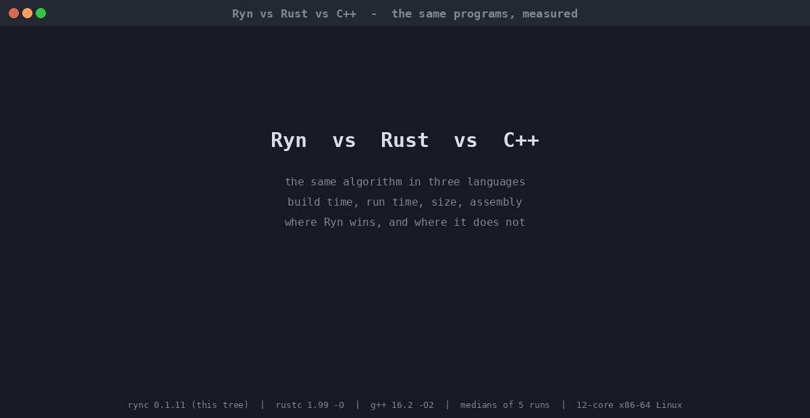

# Ryn

<p align="center">
  
</p>

**Reliable. Fast. Native.**

Ryn is a statically typed systems language that compiles to native machine code. There is no garbage
collector: ownership is checked at compile time by Ryn Guard and released deterministically. The whole
toolchain is written in Ryn: the `ryn` command, the compiler and the runtime. The compiler rebuilds itself from its
own sources, and the tree contains no Rust.

<p align="center"></p>

<p align="center"></p>

The second animation puts Ryn next to `rustc -O` and `g++ -O2` on the same programs, with the assembly of one loop: Ryn starts faster, is smaller and builds a large program 5 times faster, and is 1.3 to 4 times slower on compute-bound code (the numbers are in [docs/native-performance.md](docs/native-performance.md), the programs in [`benches/versus`](benches/versus)).

Compile times in the animation are medians of real runs on one machine (`rync` built by a `rync` of this tree, 0.1.10; the animation is typed, not a recording).

## Status

The latest release is [0.1.10](https://github.com/rynlanguage/Ryn/releases/tag/v0.1.10), "Faster code, buffered output" (see the changelog); [0.1.9](https://github.com/rynlanguage/Ryn/releases/tag/v0.1.9) was "Performance Revolution"; [0.1.8](https://github.com/rynlanguage/Ryn/releases/tag/v0.1.8) was the one before; [0.1.7](https://github.com/rynlanguage/Ryn/releases/tag/v0.1.7) was "Native Power & Benchmarks" and [0.1.6](https://github.com/rynlanguage/Ryn/releases/tag/v0.1.6) was "Native First".

- The whole toolchain is written in Ryn: the `ryn` command, the native compiler `rync` (lexer, parser,
  analysis, code generator, ELF and PE writers) and the runtime. There is no Rust code in the tree and no Cargo
  build. The compiler is built from the committed seed (`bootstrap/rync-seed`) by `tools/bootstrap-native.sh`, which
  requires stage 2 and stage 3 to be byte-identical.
- Linux x86-64 is the primary target. Windows x86-64 programs and the Windows `ryn.exe`/`rync.exe` are cross-compiled
  by the same compiler; they have been run under Wine only, not on Windows itself, and threads, sockets and
  keyboard input are not available there yet (see `docs/native-compiler.md`).
- The Rust implementation and the Cranelift backend were removed in 0.1.6. They remain in the git history before
  commit `950e152`.
- Ryn is experimental. It is not a general-purpose production language yet.

## Example

```ryn
struct Point {
    x: i32,
    y: i32,
}

fun quadrant(point: Point) -> str {
    when point.x >= 0 && point.y >= 0 {
        "first"
    } else when point.x < 0 && point.y >= 0 {
        "second"
    } else when point.y < 0 && point.x < 0 {
        "third"
    } else {
        "fourth"
    }
}

fun main() {
    origin := Point { x: 0, y: 12 }
    name := "Ryn"
    echo "Hello, {name}!"
    echo quadrant(origin)
    echo quadrant(Point { x: -3, y: 4 })
}
```

```console
$ ryn run examples/hello.ryn
Hello, Ryn!
```

The `quadrant` function above returns `"first"` for `Point { x: 0, y: 12 }`.

More runnable programs are in [`examples/`](examples/): ownership and destructors, generics,
patterns, collections, file and process APIs, FFI, and the self-hosted compiler driver.

## Install

Download a release archive from [GitHub Releases](https://github.com/rynlanguage/Ryn/releases)
(Linux x86-64 and Windows x86-64, with SHA-256 checksums), or build from source with the committed seed:

```sh
tools/bootstrap-native.sh "$PWD/bootstrap/rync-seed" /tmp/ryn-bootstrap       # rync, stage 2 == stage 3
python3 tools/make-dist.py /tmp/ryn-bootstrap/rync-stage2 "$(cat VERSION)" /tmp/ryn-dist
```

The release installers verify the archive checksum and install for the current user:

```powershell
powershell -ExecutionPolicy Bypass -File .\install.ps1
```

```bash
bash ./install.sh
```

The Linux `ryn-<version>-linux-x86_64.tar.gz` archive contains `ryn`, the compiler `rync`, the standard library,
the compiler's Ryn sources and the bootstrap script; `ryn` finds `rync` and `stdlib` next to itself.

## Quick start

```sh
ryn new hello-ryn          # scaffold a project (ryn.yaml + src/main.ryn)
cd hello-ryn
ryn check .                # analyse
ryn build .                # compile to build/debug/<name>
ryn run .                  # compile and run
ryn run app.ryn -- arg     # pass arguments after --
ryn bench app.ryn          # time the compiler and the program: warmup, median, JSON, baseline
ryn clean .                # remove build artifacts
ryn lock .                 # resolve dependencies and write ryn.lock
ryn login <token>          # save a pods registry token
ryn publish .              # check, pack and upload the package
```

A single file works too: `ryn check main.ryn`, `ryn build main.ryn -o main`, `ryn run main.ryn`.
`main` returning `i32` becomes the process exit code.

`ryn bench` compiles a file or project and times it: `--iterations N` timed runs after `--warmup N` untimed ones
(the program's output is captured), `--compile-runs N` timings of the compiler, `--json` for a machine-readable report,
`--save-baseline FILE` to keep a report and `--baseline FILE [--threshold PERCENT]` to compare medians with it (status 1
on a regression). A project with a `benches/` directory times every `.ryn` file in it.

Useful options: `--release` (outputs go to `build/release`), `-o/--output <path>`. On Windows the program is
`ryn.exe` and the executables get `.exe`; Windows support is experimental (see Status).

## Language

- Functions with typed parameters and results, early `return` or tail-expression returns, `mut`
  bindings, `name := value` and `name: Type = value` declarations.
- Control flow: `when`/`else when`/`else` as statements and as values, `while`, `for i in start..end`
  and `start..=end`, `for item in vec`, `break`, `continue`, `defer { ... }`.
- `struct` data with `extend` methods (`self`, `mut self`, associated functions and constants),
  `shape` contracts with generic bounds, `#[derive(Clone, Eq, Hash)]`, operator overloading through
  `add`/`sub`/`mul`/`div`/`rem`, and `#[drop(f)] destructors for move-only resource handles.
- `enum` with unit and tuple payloads, exhaustive `choose` with literal, tuple, struct, nested and
  binding patterns.
- Ownership: owning `String`, `Vec<T>`, `Map<K,V>`, `Set<T>`, `Option<T>`, `Result<T,E>` and
  payloads; moves, borrows and deterministic cleanup checked by Ryn Guard; no GC, no refcount.
- Generics over functions, structs, enums, aliases and `extend<T>` blocks, with inference and
  explicit type arguments.
- `const` items with a compile-time evaluator (`comptime(...)`, `static_assert(...)`,
  `field_count::<T>()`, `variant_count::<T>()`, `type_name::<T>()`, `has_field::<T>("name")`,
  `#[derive(Default)]`).
- Fixed-width integers with wrapping arithmetic, explicit `as` casts, IEEE-754 `f32`/`f64`, `char`
  and UTF-8 strings with `\u{...}` escapes.
- `extern "C"` imports, `#[repr(C)]` records, raw pointers, function pointers and callbacks.
- `?` propagation, `??` null-coalescing, `?.` optional field access, and pipes `value |> f`.

The full language surface, including known limits, is documented in
[docs/language-0.2.md](docs/language-0.2.md); ownership rules are in
[docs/memory-model.md](docs/memory-model.md).

## Standard library

`std::io`, `std::fs`, `std::path`, `std::env`, `std::math`, `std::option`, `std::result`,
`std::process`, `std::thread`, `std::time`, `std::system`, `std::net`, `std::keyboard` and
`std::arena`. The sources live in [`stdlib/std/src`](stdlib/std/src) and compile with the native
compiler.

## Documentation

| Document | Contents |
| --- | --- |
| [docs/language-0.2.md](docs/language-0.2.md) | Language features, test distribution, known limits |
| [docs/memory-model.md](docs/memory-model.md) | Ownership, moves, borrows, Ryn Guard |
| [docs/native-compiler.md](docs/native-compiler.md) | `rync`, its bootstrap and compatibility |
| [docs/self-hosting-plan.md](docs/self-hosting-plan.md) | Plan and progress toward full self-hosting |
| [docs/native-ownership-validation.md](docs/native-ownership-validation.md) | Ownership and bootstrap measurements |
| [docs/native-float-validation.md](docs/native-float-validation.md) | Freestanding float runtime validation |
| [docs/native-performance.md](docs/native-performance.md) | SIMD, atomics, threads, allocators, layout, `ryn asm`: state and limits |
| [CHANGELOG.md](CHANGELOG.md) | Release history |

## Testing

```sh
python3 tools/test-native-sources.py <rync> $(python3 tools/list-suite.py)   # the 636-program language suite
python3 tools/run-tests.py <ryn>                                           # command-line, diagnostics and runtime tests
RYN_TEST_TARGET=windows python3 tools/test-native-sources.py <rync> $(python3 tools/list-suite.py)   # under Wine
```

## Contributing

See [CONTRIBUTING.md](CONTRIBUTING.md). For questions and bug reports see
[SUPPORT.md](SUPPORT.md); security issues are handled as described in
[SECURITY.md](SECURITY.md). Contributors are listed in [CONTRIBUTORS.md](CONTRIBUTORS.md).

## License

Ryn is distributed under the [Mozilla Public License 2.0](LICENSE).
